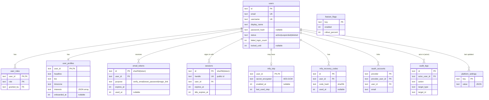
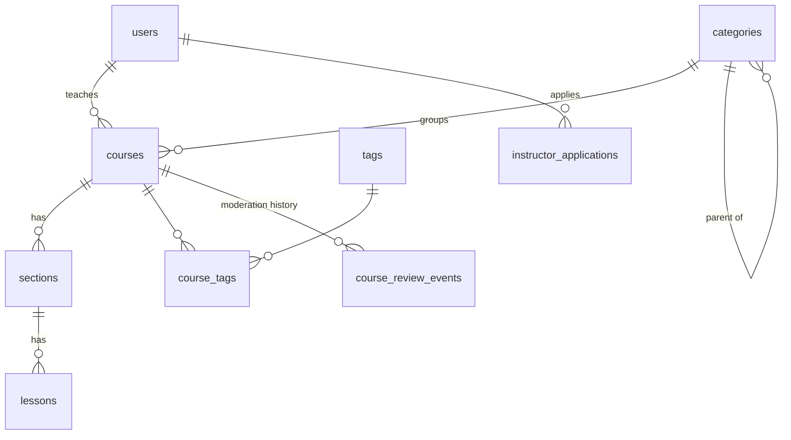

# Database schema

The authoritative definition is the code in [`packages/db/src/schema/`](../../packages/db/src/schema/), where every column has a comment. This page explains **what each table is for** and how the tables relate. Update it in the same commit as any migration (`npm run docs:check` enforces this).

**Conventions:** ids are `TEXT` UUIDv7, timestamps are `INTEGER` epoch milliseconds (UTC), money is `INTEGER` paise, booleans are `INTEGER` 0/1.

Admin account decisions use `users.status`, `sessions`, append-only `audit_logs` and a dedicated `users.admin_version` integer (default zero; incremented only by successful access decisions, migration `0012_admin_decision_version.sql`). No personal-data field is added. Migration `0011_admin_operations.sql` adds `users_created_idx(created_at, id)`, expands `users_status_idx(status, created_at, id)` and expands `audit_target_idx(target_type, target_id, created_at, id)` for bounded pagination/history. See [staff operations](admin-operations.md).

## Relationships

## Identity (`schema/identity.ts`)

### `users`

One row per account. Holds only identity and login data. Profile details live in `user_profiles`, so this table (read on every signed-in request) stays small.

- `email` and `username` are unique and stored lower-case.
- `email_verified_at` is `NULL` until the user clicks the verification link. Unverified users can sign in but can't buy, teach or post.
- `password_hash` is `NULL` for accounts that only use Google or email-link sign-in. The format is versioned (`pbkdf2$<iterations>$<salt>$<hash>`), so the algorithm can be upgraded without forcing password resets. It is selected only by the sign-in query.
- `failed_login_count` / `locked_until`: after 10 wrong passwords in a row, password sign-in is refused for 15 minutes. A successful sign-in or a password reset clears them.
- `status = 'deleted'` plus `deleted_at` records immediate anonymization. A retained tombstone preserves licensed-course foreign keys and other learners' records; no 30-day hard deletion is promised.

### `user_profiles`

One row per user, created together with the account. Public profile (headline, Markdown bio, https website, location) plus preferences: `timezone` (streaks, reminders, bookings), `interests` (JSON array of category slugs, used for recommendations) and `goal`. `onboarded_at` is `NULL` until the onboarding questions are answered, and the website shows onboarding until then.

### `email_tokens`

Single-use tokens sent in emails: `verify_email` (24 h), `reset_password` (30 min) and `magic_link` (30 min, used later in Phase 1). Only the SHA-256 of the token is stored. A token is redeemed by one atomic `UPDATE … WHERE used_at IS NULL AND expires_at > now RETURNING user_id`, so two clicks can't both succeed. Requesting a new link deletes the user's older unused links of the same purpose.

### `user_roles`

Extra roles on top of the implicit `learner`: `instructor`, `mentor`, `moderator`, `org_admin`, `admin`, `super_admin`. One row per (user, role). `granted_by` records which admin granted it (`NULL` = granted automatically). Deleting a user removes their roles.

### `sessions`

Server-side login sessions ([ADR 0005](adr/0005-server-sessions.md)). The browser keeps a random token in an HttpOnly cookie, and this table stores only **its SHA-256 hash**, so a database leak can't be used to log in. Two expiries: `idle_expires_at` (sliding, 7 days) and `expires_at` (absolute, 30 days). `mfa_verified` records whether 2FA was completed in this session. `ip_hash` is a salted hash, never the raw IP. `handle` is a separate public UUID used by the "your devices" screen and the revoke endpoint, so the token hash never leaves the server. `last_seen_at` and the idle expiry are refreshed at most once an hour, which keeps writes low.

### `mfa_totp`

The authenticator-app second factor, at most one per user. `secret_encrypted` is the shared TOTP secret encrypted with AES-256-GCM using the `MFA_ENCRYPTION_KEY` secret, so a database leak alone can't generate codes. `enabled_at` is `NULL` while setup is unconfirmed; 2FA is only enforced once it is set. `last_used_step` is the 30-second time step of the last accepted code; codes for that step or earlier are rejected (no replay). It is updated atomically.

While 2FA is on, signing in with a password (or an email link, or Google) creates a _pending_ session (`sessions.mfa_verified = 0`, 10-minute idle expiry) that can only submit a code. `sessions.mfa_attempts` counts wrong codes, and the pending session is deleted after 5.

### `mfa_recovery_codes`

Ten single-use backup codes per user, issued when 2FA is turned on or regenerated. Only the SHA-256 of each normalised code (upper-case, no dash) is stored. `used_at` marks a code as spent, and regenerating deletes all previous codes.

### `oauth_accounts`

External sign-in identities (Google) linked to a user, keyed by (`provider`, `provider_user_id`). The provider's stable user id (Google's `sub`) is used, never the email, which can change. A user can have a password, a Google identity, or both.

## Catalog (`schema/catalog.ts`)

### `categories`

Top-level subjects (and optional sub-categories via `parent_id`). The 12 top-level categories are created by the **data migration** `0004_seed_categories.sql`, so they exist in every environment. Their slugs match the onboarding interests (`INTEREST_OPTIONS`), so a learner's interests map straight to categories. `icon` is a lucide icon name and `position` sets menu order.

### `tags` and `course_tags`

Free-form topic labels ("react", "excel", "guitar-chords") shared across courses, linked many-to-many. Tags are created when an instructor first uses them. Slugs are unique and normalised.

### `courses`

One row per course, owned by `instructor_id`. The owner can't be deleted while they own courses (`RESTRICT`): enrolled learners must keep access, so account deletion has to transfer or archive courses first.

- **Status lifecycle:** `draft` → (instructor submits) `in_review` → (reviewer) `published` or `rejected` (with `review_notes`). A rejected course goes back to editing and can be resubmitted. Published courses can be `archived`.
- **Price:** `price_in_paise` (0 = free), currency `INR`. Payments arrive in Phase 2.
- **Denormalised counters:** `lesson_count` and `duration_minutes` are recomputed whenever lessons change; `enrollment_count`, `rating_sum` and `rating_count` are updated as learners enrol and review. Average rating = `rating_sum / rating_count` (integers, so no rounding drift).
- `learning_outcomes` and `requirements` are JSON arrays of short strings. `description` is Markdown.
- Indexes serve the catalog (`status, published_at`), category pages (`category_id, status`) and the instructor's studio (`instructor_id, updated_at`).

### `sections` and `lessons`

A course is divided into ordered sections, and each section into ordered lessons (`position`).

- `lessons.course_id` is denormalised from the section, so course-wide queries (counts, the player's outline) need no join.
- `type` is one of `video`, `article`, `quiz` or `code` (quiz and code content arrive with their features).
- `is_preview`: visible on the course page without enrolling.
- **Video:** `video_provider` (`youtube`, `vimeo` or `r2`) plus `video_ref`, which holds the provider's video id or an R2 object key, **never a raw URL**. The page builds the embed URL itself, so no arbitrary URL can be injected into an iframe.
- `content_markdown` holds the article body or notes under a video, and is rendered sanitised.
- `video_learning` stores optional validated JSON chapters, timed transcript and reflection checkpoints. Migration `0010_video_learning.sql` defaults old lessons to `{}`. The content follows lesson-body permissions, is bounded to 48,000 UTF-8 bytes, and is absent from public metadata. See [video learning](video-learning.md).

### `instructor_applications`

Requests to teach. `topics` is a JSON array of category slugs, and `sample_url` is an https link to a teaching sample. A reviewer (admin or moderator) approves, which **grants the `instructor` role** in `user_roles`, or rejects with `review_notes`. A guarded insert prevents concurrent submissions from creating more than one pending application. Submission/audit and decision/status/role writes use atomic D1 batches.

Statuses are `pending`, `approved`, `rejected` and `withdrawn`. Additive migration `0013_instructor_application_withdrawal.sql` adds nullable millisecond timestamp `withdrawn_at`; withdrawal is terminal and leaves reviewer fields null. Reapplication creates a new row, preserving history. Owner history returns the latest 20 in stable `(created_at, id)` order and excludes reviewer identity. See [teaching](teaching.md) and [ADR 0012](adr/0012-instructor-application-decisions.md).

### `course_review_events`

Append-only moderation history per course: `submitted`, `approved`, `rejected` (with notes) and `archived`, with who did it and when. The course row shows only the latest state; this table shows how it got there.

## Learning (`schema/learning.ts`)

### `enrollments`

One entitlement per `(user_id, course_id)`, enforced by a unique index. `source` records free/purchase/plus/org/gift origins; currently only verified free enrollment is issued. `last_accessed_at` sorts the learning shelf and `completed_at` tracks completion of the current curriculum. User deletion cascades learning data; course deletion is restricted while enrollments exist, preserving learner access.

### `lesson_progress`

Composite primary key `(enrollment_id, lesson_id)` makes completion idempotent. `completed_at` is nullable, so undo preserves the row without counting it as completed. Lesson deletion cascades progress. Services verify both enrollment ownership and lesson/course membership.

### `notes`

Private lesson notes belonging to an enrollment. `body` is sanitized Markdown on display. Optional `timestamp_seconds` links a video note to a moment. Indexed by enrollment, lesson and creation time; never included in public catalog/profile responses.

### `reviews`

One public review per enrollment, with denormalized course/user IDs, integer 1–5 rating and bounded text. Unique enrollment ownership prevents duplicate reviews. Writes recompute the course rating sum/count in the same batch. The service requires verified email and a completed lesson, and rejects the instructor's own review.

### `certificates`

One immutable completion record per enrollment, addressed by a random `serial`. Snapshots learner name, course title/slug, instructor name, lesson count and issuance time, with an HMAC-SHA256 `signature`. Issuance checks current completion in SQL; public verification checks every signed claim. Preserve `CERTIFICATE_SIGNING_KEY` across deployments and restores. See [learning architecture](learning.md) for lifecycle and privacy details.

### `courses_fts`

FTS5 virtual table over course title, subtitle and description, linked to `courses.rowid`. Custom migration `0006_catalog_search.sql` rebuilds it and adds insert/update/delete synchronization triggers. Queries bind quoted prefix terms and independently require published/active instructor status; the search index never determines access rights.

## Community (`schema/community.ts`)

### `discussion_questions`

Enrollment-scoped course questions with optional lesson/video timestamp context. Stores bounded Markdown and an accepted reply reference verified by the service. Hidden questions are excluded from learner responses. Author deletion preserves the conversation; lesson deletion removes the lesson reference.

### `discussion_replies`

Replies belong to one question and preserve history on author deletion. Hidden replies are excluded from all learner reads. Staff hiding an accepted reply clears its solution reference atomically.

### `content_reports`

Private abuse reports targeting a question, reply or review. A unique reporter/target key deduplicates retries. Staff decisions carry feedback, an optimistic version and an operation token, guarding content visibility changes and append-only audit writes in one D1 batch. See [community architecture](community.md).

Reviews also store `hidden_at`, `moderated_by` and private moderation feedback. Hidden reviews remain author-editable but do not contribute to public ratings until staff restore them.

## Notifications (`schema/notifications.ts`)

### `notifications`

Persistent user-scoped alerts with server-generated kind, text and internal destination. Indexed by recipient/creation and unread state. Unique event/recipient keys deduplicate retries. Inserts share the originating discussion or moderation transaction. Only the recipient can read or mark an alert; user erasure cascades the inbox.

### `notification_preferences`

One preference row per user. Discussion alerts default to enabled. Turning them off suppresses future Q&A alerts; moderation decisions remain enabled. See [notification architecture](notifications.md).

## Practice quizzes (`schema/quizzes.ts`)

### `lesson_quizzes`

One quiz definition per lesson, including private correct choice IDs and explanations in validated JSON. A UUIDv7 revision changes when the definition changes. Owner/staff editor paths can read answer keys; learner pre-submission views omit them.

### `quiz_attempts`

Immutable enrollment/lesson-scoped selections and server-graded result snapshots for one revision. A client UUIDv7 primary key deduplicates retries; an internal receipt guards the progress effect of a winning insert. An enrollment/lesson/creation index supports private history and the atomic 20-attempt hourly limit. Deleting an enrollment or lesson cascades attempts. See [quiz architecture](quizzes.md).

## Platform (`schema/platform.ts`)

### `platform_settings`

Admin-editable configuration as key → JSON value, e.g. `commerce.platform_fee_bps = 3000` (30%). Business numbers live here instead of in code, so they can change without a deploy. The defaults are loaded by `packages/db/seed/seed.sql`.

### `feature_flags`

On/off switches with a percentage rollout. Unfinished features ship disabled and are enabled gradually. Public flags are exposed through `GET /api/v1/meta` (cached for 60 s per Worker instance).

### `audit_logs`

**Append-only** record of security- and money-relevant actions: logins, role changes, refunds, payouts, admin edits. Application code only ever inserts into it. `metadata` is JSON and must never contain secrets or full payment details. `request_id` links to the API log line.

## Planned tables (by phase)

Documented here when their migration is written:

| Phase | Tables                                                                                                                                    |
| ----- | ----------------------------------------------------------------------------------------------------------------------------------------- |
| 1     | R2 upload metadata as the upload workflow ships (video timelines, learning, quizzes, Q&A, reports and notifications are implemented)      |
| 2     | products, prices, carts, orders, payments, refunds, coupons, invoices, ledger entries, payout accounts, payouts, referrals, webhook inbox |
| 3     | XP events, achievements, streaks, challenges, problems, submissions, contests, learning paths, study pods                                 |
| 4     | exams, question banks, attempts, credentials, capstone projects, peer reviews                                                             |
| 5     | mentor profiles, availability, bookings, skill-swap offers and matches, time-credit ledger, conversations, messages, bounties             |
| 6     | plans, subscriptions, revenue pool periods, sponsored campaigns, flashcards, pledges, scholarships                                        |
| 7     | organizations, members, seat assignments, job posts                                                                                       |

## Reviewed publication additions (0014?0015)

`courses.source_course_id` links private revisions to originals; `base_version` pins the source publication and `version` guards content/lifecycle decisions. A partial unique index permits one active revision per original. Curriculum/content triggers advance the version and block edits during review. Learner counter updates do not invalidate revisions.

`sections.source_section_id` and `lessons.source_lesson_id` map private copies back to stable live IDs. `retired_at` retains removed curriculum rows for older enrollment links, notes, progress and discussion foreign keys while excluding them from current curriculum and completion counts. `course_review_events` also records `restored`, `taken_down` and `revision_approved`. See [course revisions](course-revisions.md).

## Staff controls and observations (0016 and 0017)

`platform_settings.version` and `feature_flags.version` guard stale decisions.
Only allowlisted operational integer settings and `auth.google` are writable by
super admins through fresh security checks. Protected `security.bootstrap_completed`
records the one-time operator provisioning. Defaults are seeded by the migration,
without loading demo identities or courses.

`sessions.step_up_nonce` and `step_up_at` hold a server-only single-use proof valid
for 60 seconds. Successful role/control decisions consume it atomically with audit
and state changes. `mfa_attempts` also counts failed staff proof checks. Role changes
increment `users.admin_version` and revoke target sessions. Global audit paging has
`audit_created_idx(created_at,id)` and exact target filtering has
`audit_target_id_idx(target_id,created_at,id)`.

### `operational_metrics`

Aggregate five-minute UTC counters keyed by `(bucket,scope)`: requests, errors,
rate-limited/slow requests and total capped duration. At most six coarse request
groups; no paths, account/IP identities or request bodies. Opt-in recording and
bounded retention maintenance are described in the [staff runbook](../operations/staff-controls.md).

### `operational_alerts`

One `(bucket,kind)` receipt for each request-volume/error/slow/rate-limit threshold.
Stores a random ID, observed count, delivery state, attempt count, next attempt
and update time. Claim leases protect concurrent senders; at most three attempts
and bounded retention. The webhook URL remains an environment secret, never a
column. Audit records are not deleted by operational retention maintenance.

## Private eligibility, identity and rights (0018-0023)

| Table                    | Private purpose                                                                                                                                         |
| ------------------------ | ------------------------------------------------------------------------------------------------------------------------------------------------------- |
| `account_privacy`        | Private birth date, current agreement versions, scoped guardian link, external-media preference and optimistic rights version. No public DOB selection. |
| `guardian_requests`      | Adult guardian's scoped consent, state/version and minimal audited provider receipt. Staff can reject; provider reads alone approve.                    |
| `guardian_invitations`   | Hashed one-use 14-day code, child email hash/birth date, expiry and consumed owner. Cleared/expired on use, withdrawal and cleanup.                     |
| `guardian_verifications` | Session/state-bound Setu attempts, unique provider request ID, verification/revocation times. No document/number/name/photo/address fields.             |
| `teacher_verifications`  | Own teacher identity receipt and 180-day validity, separate from teaching-quality approval and guardian scope.                                          |
| `privacy_exports`        | Owner-only NDJSON build cursor/resource/part/byte count, durable lease and 24-hour expiry/state.                                                        |
| `privacy_export_parts`   | Bounded private NDJSON parts keyed by export/part; streamed only with current owner/session proof.                                                      |
| `support_requests`       | Private verified guest/owner Contact tickets, hashed confirmation token, version and resolution/retention dates.                                        |
| `support_replies`        | Private staff responses with delivery state, lease, at most three attempts and idempotency identifier.                                                  |

`sessions.privacy_access_until` stores a ten-minute owner download proof window.
Learning/publication/content-write and role triggers recheck current eligibility
and teacher identity. The birth-date trigger blocks ordinary changes; exceptional
verified corrections require an audited operator workflow. Parent consent
withdrawal cannot race an otherwise authorized child write. Schema changes do
not invent agreement acceptance or birth dates for legacy accounts.

See [privacy operations](../operations/privacy.md) and
[ADR 0016](adr/0016-private-consent-and-cloudflare-vercel.md).
