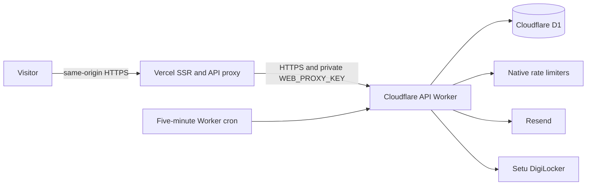

# Deploy the backend on Cloudflare and the frontend on Vercel

This is the current hosting target. The Hono API runs directly on Cloudflare
Workers with D1, native rate limiting and scheduled maintenance. React Router
renders on Vercel and forwards `/api/*` through its server. Render and its D1
gateway are not required.



The API checks the proxy secret before trusting Vercel's visitor IP. Session
cookies, CSRF Origin checks and CSP nonces remain on the frontend origin.
Notifications use authenticated inbox polling on Vercel; the optional two-Worker
hosting target also supports WebSockets.

## Current resource preparation

On 2026-10-14, isolated D1 databases were created and migrations `0000` through
`0022` were applied to both. These databases contain schema/default categories,
not demo accounts or demo courses. Apply the later `0023` teaching-write guard
migration before deployment:

| Environment | Database             | ID                                     |
| ----------- | -------------------- | -------------------------------------- |
| Staging     | `skillverse-staging` | `94a3e213-ad4e-42a3-8277-0c8155603ad6` |
| Production  | `skillverse-prod`    | `d2381b82-cf90-4467-8cfb-23b5a8911446` |

The Vercel project `kanavt15/skillverse` was created and configured with root
directory `apps/web` and Node 22. **No Worker or Vercel deployment was published.**
The owner requested a code/deployment handoff. Local project links and secret
files are ignored by Git. For another account, create separate databases and
replace the environment IDs in `apps/api/wrangler.jsonc`; keep the top-level
local `skillverse-dev` binding separate.

## 1. Verify the checkout

Run from the directory with the root `package.json` (the inner `SkillVerse`
directory in this checkout). Use Node 22.22.2 or a compatible later Node 22 patch.

```sh
npm ci
npm run check
npm run format:check
npm run test:e2e
npm run test:vercel
```

Browser fixtures refuse a real email provider. Start local API testing with a
temporary `--env-file` containing blank Resend, Setu, Google secret, Turnstile and
alert receiver values. Do not run synthetic account/identity fixtures against
production. Local seeds are development-only.

## 2. Configure private production settings

`apps/api/.env.production` was created locally with new signing/proxy keys.
Preserve these keys in your password manager and backups. Replace the currently
rejected Resend key; do not commit or paste credentials into public channels.
On another machine, create the same ignored file from this structure:

```dotenv
IP_HASH_SALT=<32 or more random bytes, hex>
MFA_ENCRYPTION_KEY=<exactly 64 hex characters>
COOKIE_SIGNING_KEY=<32 or more random characters>
CERTIFICATE_SIGNING_KEY=<32 or more random characters; keep stable>
WEB_PROXY_KEY=<32 or more random characters; same value on Vercel>
RESEND_API_KEY=<valid Resend key with domain-read and email-send access>
EMAIL_FROM="SkillVerse <no-reply@your-verified-domain.com>"
SETU_CLIENT_ID=<live DigiLocker x-client-id>
SETU_CLIENT_SECRET=<live DigiLocker x-client-secret>
SETU_PRODUCT_INSTANCE_ID=<live DigiLocker x-product-instance-id>
LEGAL_OPERATOR_NAME="Your actual legal operator name"
LEGAL_OPERATOR_COUNTRY="India"
```

For random keys, use a password manager or Node's `crypto.randomBytes(32)`.
Do not replace the MFA or certificate signing key after users/credentials exist:
their encrypted factors and signatures depend on those keys.

In [Resend](https://resend.com/api-keys), create a valid key, verify your sending
domain and choose a transactional sender on that domain. The supplied key
returned HTTP 401 during read-only validation. Do not use `resend.dev`, `.test`
or a fabricated sender for public signup. `EMAIL_FROM` is a transactional sender;
the website publishes no support email.

Enable DigiLocker in [Setu Bridge](https://bridge.setu.co) and obtain live
credentials for the enabled product instance. Setu may require organization
onboarding and provider approval. The header-to-setting mapping is:

| Setu header             | Worker setting             |
| ----------------------- | -------------------------- |
| `x-client-id`           | `SETU_CLIENT_ID`           |
| `x-client-secret`       | `SETU_CLIENT_SECRET`       |
| `x-product-instance-id` | `SETU_PRODUCT_INSTANCE_ID` |

Sandbox uses `https://dg-sandbox.setu.co`; production uses `https://dg.setu.co`.
The code permits only these fixed provider origins. Redirects go to
`https://<frontend>/settings/guardians` and
`https://<frontend>/settings/teacher-verification`, with a session-bound state.
Enable the required identity-document consent scope with Setu. Callback query
claims do not approve anyone: the server reads authenticated request status and
identity data, checks the signature result/name/birth date/age, stores a minimal
receipt and revokes provider access. See [Setu's integration guide](https://docs.setu.co/data/digilocker/quickstart).

Review public policies with the actual operator and applicable jurisdiction
before opening accounts. DigiLocker verifies identity/age; parental or legal
guardianship is a separate explicit declaration. Assess this relationship
verification and child-safety process during operator/provider review. Do not
claim a legal review or live provider acceptance based on local mocks.

Google sign-in, Turnstile and the operational webhook are optional. Follow the
existing [Google guide](../guides/google-sign-in.md),
[bot protection guide](../guides/bot-protection.md) and
[staff runbook](staff-controls.md) if enabling them. Keep Google off until its
real redirect configuration and account/MFA journeys pass.

## 3. Check D1 and build the Worker

```sh
cd apps/api
npx wrangler login
npx wrangler d1 migrations list DB --remote --env production
npx wrangler d1 migrations apply DB --remote --env production
cd ../..
npm run deploy:cloudflare -- --environment production --frontend https://skillverse-kanavt15.vercel.app --dry-run
```

The release helper checks the required private settings and verified Resend
sender before opening account services. `--dry-run` builds locally and never
publishes a Worker. For a new account/database, first run `wrangler d1 create`
without `--binding` (that flag edits the top-level development binding), put the
returned ID in the chosen environment, and apply migrations with
`wrangler d1 migrations apply DB --remote --env <environment>`.

Do not run `db:reset` or demo seeds against a deployed database. Back up an
existing database before new migrations. All new account/identity/privacy
migrations are additive and avoid fabricating birth dates for legacy users.
Legacy users must explicitly confirm eligibility; instructors must also verify
their own identity before public discovery/Studio access resumes.

## 4. Deploy the API yourself

After checks and provider/operator setup:

```sh
npm run deploy:cloudflare -- --environment production --frontend https://skillverse-kanavt15.vercel.app
```

The helper uploads only allowlisted Worker secrets using a temporary ignored
file, deletes that temporary file afterwards, and sets the sender, exact allowed
frontend origin and `PUBLIC_LAUNCH_READY=on`. Record the HTTPS `workers.dev` URL
printed by Wrangler as the Vercel `API_BASE_URL`. `/api/health` is deliberately
public; other API access on this target requires the private proxy key.

An explicit closed preview can be built/deployed with `--preview`. It sets
`PUBLIC_LAUNCH_READY=off`, excludes provider credentials and disables new
signup/Contact submissions. A closed preview is not evidence that email or
identity verification works in production. The raw `deploy:api` command retains
the safe, closed configuration unless you explicitly change it.

Use separate keys in `apps/api/.env.staging` for staging; the same helper accepts
`--environment staging`. Keep staging origins, D1 and Vercel Preview settings
separate from production. With a custom frontend URL, supply that exact origin
instead of the example in every command.

## 5. Configure and deploy Vercel yourself

Import the repository or link it with the Vercel CLI. Project settings:

| Setting         | Value                                  |
| --------------- | -------------------------------------- |
| Framework       | React Router                           |
| Root directory  | `apps/web`                             |
| Node            | `22.x`                                 |
| Install command | `cd ../.. && npm ci`                   |
| Build command   | `cd ../.. && npm run build:web:vercel` |

Keep access to files outside the root directory enabled for workspace packages.
`apps/web/vercel.json` records build/install commands and immutable asset headers.
`.vercelignore` excludes private env files, local databases, fixture state and
credentials from CLI uploads.

Add server-side Vercel environment variables (no `VITE_` prefix):

| Variable                  | Value                                             |
| ------------------------- | ------------------------------------------------- |
| `ENVIRONMENT`             | `production`                                      |
| `API_BASE_URL`            | API Worker HTTPS origin, without path/query       |
| `WEB_PROXY_KEY`           | Same private key as the Worker                    |
| `PUBLIC_OPERATOR_NAME`    | Actual reviewed operator name                     |
| `PUBLIC_OPERATOR_COUNTRY` | Actual operator country                           |
| `TURNSTILE_SITE_KEY`      | Optional public site key, matching the API secret |

Deploy from the repository root so all workspace source is uploaded:

```sh
npx vercel link
npx vercel --prod
```

Select `kanavt15/skillverse` for this prepared account, or your own project. The project
root directory selects `apps/web` for its build. Redeploy after changing settings.
Use an available project-specific frontend alias, such as
`skillverse-kanavt15.vercel.app`, and ensure `APP_ORIGINS`, email links and Setu/
Google redirects all use that final origin. If Vercel assigns a different alias,
update the Worker origin through the release helper before testing forms.

## 6. Provision the initial staff account

Register your own real adult account, verify its email, accept current policies,
choose a password, and enable MFA. Do not seed demo accounts or fabricate a birth
date in production. Obtain your own account UUID from your authenticated `/me`.
Then use the trusted Cloudflare CLI, initially as a dry-run:

```sh
npm run admin:bootstrap:cloudflare -- --environment production --user <your-account-uuid> --reason "Initial operator provisioning after ownership review"
npm run admin:bootstrap:cloudflare -- --environment production --user <your-account-uuid> --reason "Initial operator provisioning after ownership review" --apply
```

One atomic D1 file grants the first super-admin role, records an audit/one-time
marker and revokes old sessions. It refuses non-adult, unverified, passwordless
or MFA-less targets and refuses another initial admin once an admin or marker
exists. Sign in again with MFA. No public bootstrap endpoint exists. Later staff
grants use independent, freshly verified super-admin decisions in the app.

## 7. Run launch acceptance on your deployment

Use consenting real operator/test participants, not local synthetic fixtures:

- Verify health, same-origin cookies, direct API rejection without the proxy key,
  cross-site form rejection and the private mailbox returning 404.
- Exercise registration/email verification, login, email sign-in, password reset,
  MFA enrollment/challenge/recovery and device revocation with delivered mail.
- Verify an adult guardian through live DigiLocker, issue a code, create the
  authorized child account, and withdraw permission. Confirm session revocation
  and blocked domain writes. Learning starts at 10; teaching at 16. Never test
  with a real child before the guardian/operator safeguards are accepted.
- Verify a teacher's identity, submit an application, approve it through an
  independent staff account, publish a reviewed course, enroll, use article/video/
  quiz learning, save notes, review, ask/reply/report, and verify a certificate.
- Check external video consent off by default, explicit adult opt-in and immediate
  withdrawal on navigation/reload. Minor accounts must never load embeds.
- Confirm private guest support on POST, a staff reply with actual email delivery,
  owner-only export/download and deletion. Check preserved courses/other learners'
  credentials and erased owner records. Use only accounts you intend to delete.
- Confirm the five-minute cron builds exports, expires parts/invitations, removes
  resolved support and retries provider revocation/outbound replies. It runs even
  with operational telemetry off. Review usage and configure account alerts.

Live Setu, email deliverability, operator/legal review and production recovery
evidence are deployment-owner acceptance tasks. Local tests validate implementation
and failure boundaries; they cannot manufacture provider approval.

## 8. Recovery

Record Worker version/deployment IDs, frontend deployment IDs and stable signing
keys. Take a D1 export/Time Travel recovery point before schema updates and test
restoring into a separate database. Worker/Vercel rollback restores code, not D1
state. Do not roll back to code that permits teaching or children without current
identity/consent guards. Prefer a compatible forward fix or close new account
services temporarily. See [backups](backups.md) and
[Cloudflare versions/deployments](https://developers.cloudflare.com/workers/versions-and-deployments/).

Rotate `WEB_PROXY_KEY` on both platforms together. Do not casually rotate MFA or
certificate signing keys. Retained tombstones preserve licensed course foreign
keys; account deletion is immediate anonymization rather than a promised 30-day
hard deletion. See the [privacy operations guide](privacy.md).
