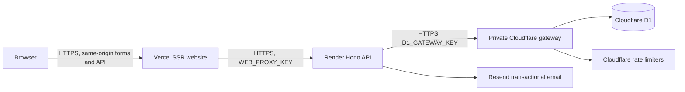

# Deploy the API on Render and the website on Vercel

This deployment keeps Cloudflare D1. The API runs as a Node service on Render;
React Router renders the website on Vercel. A small private Cloudflare Worker
provides D1 operations and the existing Cloudflare rate limiters.



The gateway executes each application database batch in one D1 transaction.
It does not retry writes automatically. Cloudflare recommends a Worker proxy
for application access to D1; its administrative REST API is subject to the
global Cloudflare API rate limit. [Cloudflare's D1 proxy guide](https://developers.cloudflare.com/d1/tutorials/build-an-api-to-access-d1/).

This guide and the adapters are implemented. Account creation, DNS, provider
activation, remote migrations, deployment, production smoke tests and recovery
evidence must be completed in your own accounts. The remaining release gates in
[TODO](../../TODO.md) still apply; this guide does not enable paid checkout.

## 1. Prepare the repository

Use the directory containing the root `package.json` and `render.yaml`.
In this checkout that is `SkillVerse`, inside the outer `Skill-Verse` folder.
Commit and push your reviewed code before connecting either hosting service.

Use Node **22.22.2 or a later compatible Node 22 patch** with npm 10+:

```sh
npm ci
npm run check
npm run test:node
npm run format:check
npm run build:api:node
npm run test:vercel
```

`build:api:node` bundles the existing Hono application into
`apps/api/dist/node-app.mjs`. `start:api:node` starts the Render HTTP service.
`build:web:vercel` enables the Vercel preset and Node SSR adapter. Normal
`npm run dev` and `npm run build` retain the Cloudflare development/deployment
target. The Vercel build inlines its SSR helper; the Vercel preset and parser tools are development dependencies. The adapter preserves the nonce context, security headers,
same-origin CSRF checks and session-cookie relay.

## 2. Create separate D1 databases and gateways

From `apps/api`, authenticate Wrangler and create your databases:

```sh
npx wrangler login
npx wrangler d1 create skillverse-staging
npx wrangler d1 create skillverse-prod
```

Copy each returned database ID into the matching environment in
`apps/api/wrangler.gateway.jsonc`. Keep database IDs separate for staging and
production. The gateway is the only Worker required for this hosting target;
you do not also deploy the Cloudflare API and web Workers to the same domain.

Back up an existing database before applying migrations. Apply all migrations,
including `0014_course_revisions.sql` and `0015_revision_constraints.sql`:

```sh
npx wrangler d1 migrations apply DB --remote --config wrangler.gateway.jsonc --env staging
npx wrangler d1 migrations apply DB --remote --config wrangler.gateway.jsonc --env production
```

Generate a different gateway key for each environment, then store it securely:

```sh
node -e "console.log(require('node:crypto').randomBytes(32).toString('hex'))"
npx wrangler secret put GATEWAY_KEY --config wrangler.gateway.jsonc --env staging
npx wrangler secret put GATEWAY_KEY --config wrangler.gateway.jsonc --env production
npx wrangler deploy --config wrangler.gateway.jsonc --env staging
npx wrangler deploy --config wrangler.gateway.jsonc --env production
```

Paste the respective key at each secret prompt; record it in your password
manager. Keep the HTTPS gateway URL printed by each deployment. Set the same
key as `D1_GATEWAY_KEY` on its corresponding Render service. These keys grant
database access and belong only in server secret stores.

The gateway requires authentication even for reads, accepts only bounded JSON
requests and returns generic provider failures. Restrict access further with
Cloudflare controls if your account supports them. Monitor Worker/D1 usage:
large curriculum revisions can exceed the free plan's query budget. See
[Cloudflare limits](https://developers.cloudflare.com/workers/platform/limits/).

Never run local demo seeds against production.

## 3. Deploy the API on Render

Create a Render **Web Service** from the Git repository. Set the root directory
to the repository directory containing `render.yaml` (if the Git repository
already starts there, leave Root Directory empty). Alternatively, create a
Blueprint from `render.yaml` and review its plan and environment settings.

| Render setting    | Value                                         |
| ----------------- | --------------------------------------------- |
| Runtime           | Node                                          |
| Build command     | `npm ci && npm run build:api:node`            |
| Start command     | `npm run start:api:node`                      |
| Health check path | `/api/health`                                 |
| Node version      | `22.22.2` or a compatible later Node 22 patch |

The server binds to `0.0.0.0` and Render's `PORT`; no persistent Render disk is
needed because application data stays in D1. These settings follow Render's
[web service requirements](https://render.com/docs/web-services).

Set the following variables in Render's environment settings:

| Variable                                    | Value / purpose                                                                                                                |
| ------------------------------------------- | ------------------------------------------------------------------------------------------------------------------------------ |
| `ENVIRONMENT`                               | `production`, or `staging` for the separate staging service                                                                    |
| `APP_ORIGINS`                               | Exact website origins separated by commas; put the canonical public origin first, e.g. `https://your-site.vercel.app`          |
| `D1_GATEWAY_URL`                            | Corresponding gateway HTTPS origin, with no path or query                                                                      |
| `D1_GATEWAY_KEY`                            | Its `GATEWAY_KEY` from step 2                                                                                                  |
| `WEB_PROXY_KEY`                             | New random secret of at least 32 characters; copy the same value to Vercel                                                     |
| `EMAIL_FROM`                                | Verified Resend sender, e.g. `SkillVerse <no-reply@your-domain>`; this is a transactional sender, not a public support address |
| `RESEND_API_KEY`                            | Key from the verified Resend account                                                                                           |
| `IP_HASH_SALT`                              | Separate random secret, at least 32 characters                                                                                 |
| `MFA_ENCRYPTION_KEY`                        | Exactly 64 hexadecimal characters; encrypts stored TOTP secrets                                                                |
| `COOKIE_SIGNING_KEY`                        | Separate random secret, at least 32 characters                                                                                 |
| `CERTIFICATE_SIGNING_KEY`                   | Separate stable random secret, at least 32 characters                                                                          |
| `ENFORCE_ADMIN_MFA`                         | `on`; required by this runtime                                                                                                 |
| `PASSWORD_BREACH_CHECK`                     | `on`; required by this runtime                                                                                                 |
| `GOOGLE_CLIENT_ID` / `GOOGLE_CLIENT_SECRET` | Optional matching OAuth client credentials                                                                                     |
| `TURNSTILE_SECRET_KEY`                      | Optional bot-protection secret; pair with Vercel's public site key                                                             |

Use the random-secret command above separately for each secret. Preserve the
existing MFA and certificate keys when moving an existing installation. Keep
recoverable copies of those keys with your protected database backups.

Save the service URL, such as `https://your-api.onrender.com`, for step 4.
After deployment, `/api/health` should return `status: "ok"` and database `up`.
Other Render routes require the private Vercel proxy key; direct anonymous
access returns 403. This keeps browser cookies on the website origin.

## 4. Deploy the website on Vercel

Import the same Git repository and select **`apps/web`** as Root Directory.
Allow the project to include source files outside that directory so the
workspace packages and root lockfile are available. Select the **React Router**
framework and Node 22.x. Keep the install/build commands supplied by
`apps/web/vercel.json`; leave Output Directory at the framework default.

The official Vercel preset builds SSR functions, and the custom server entry
supplies the nonce context and API proxy. See Vercel's
[React Router deployment documentation](https://vercel.com/docs/frameworks/frontend/react-router).

Set these server environment variables, then redeploy:

| Variable             | Value                                                |
| -------------------- | ---------------------------------------------------- |
| `ENVIRONMENT`        | `production` or `staging`, matching the API          |
| `API_BASE_URL`       | Corresponding Render HTTPS origin; no `/api` suffix  |
| `WEB_PROXY_KEY`      | Exact value from that Render service                 |
| `TURNSTILE_SITE_KEY` | Optional public key corresponding to Render's secret |

Do not prefix `WEB_PROXY_KEY` or `API_BASE_URL` with `VITE_`. They are read only
on the server. Every `/api/*` request goes through the Vercel SSR entry, which
adds the server secret and preserves API cookies and redirect responses.
Hashed static assets can be cached; authenticated SSR/API responses must not
be configured with public CDN caching.

After Vercel assigns the website URL, set that exact origin in Render's
`APP_ORIGINS`, then redeploy Render. When adding a custom domain, put it first
and update the providers' callback/hostname configuration as well.

Use a stable staging website/API/database pair. Arbitrary preview URLs are
not automatically trusted by CSRF checks. Explicitly allow only previews that
are intended to access that staging environment; keep production separate.

## 5. Configure sign-in and notification behavior

Google redirects to the **website** URL:
`https://your-website/api/v1/auth/google/callback`. Configure that URL with
Google and enable the Google feature as described in the
[Google sign-in guide](../guides/google-sign-in.md). Never use the Render host
as the public callback. Email verification, resets and sign-in links use the
first `APP_ORIGINS` entry.

Configure Turnstile for the public website hostname using the
[bot-protection guide](../guides/bot-protection.md). Verify real delivery from
the authenticated sender to a mailbox you control.

The Cloudflare-only deployment retains Durable Object WebSockets. On
Render/Vercel the persistent notification inbox works normally; the badge
polls every 30 seconds while visible when WebSockets are unavailable and also
refreshes on focus. The live endpoint returns 426. Do not proxy a Cloudflare
WebSocket upgrade through a Vercel SSR function.

Enforced application roles and MFA protect staff routes on this hosting
target. The existing Cloudflare Access policy is not automatically transferred
to Vercel. Review and configure any additional staff access perimeter before
launch, and follow the [initial super-admin provisioning runbook](staff-controls.md).

## 6. Validate the deployed environment

Complete these checks on staging first and retain dated results:

1. Check `/api/health` through Vercel and directly on Render. Confirm an
   unauthenticated gateway query and a direct Render catalog call are denied.
2. Register, verify an email, log in, reset a password and sign out. Confirm
   cookies use `Secure`, `HttpOnly`, `Path=/`, `SameSite=Lax` and the
   `__Host-sv_session` name on the website host.
3. Test Google and Turnstile if enabled, including an invalid callback and
   failed bot check. Verify cross-origin form submissions are rejected.
4. Exercise instructor submission, independent staff review and MFA. Submit
   and approve a revision; check that it was private until approval. Exercise
   archival/restoration and verify stale decisions return 409.
5. Enroll, save a note, complete an article/quiz and issue a certificate. Verify
   the signed certificate while logged out and confirm old certificates
   remain valid after a reviewed edit.
6. Verify notification polling/inbox updates, API/auth limits, mobile layouts,
   CSP headers and actual email delivery. Record latency and hosting usage;
   the Render-to-Worker hop has not been measured in production here.

Availability of deployment adapters is separate from release readiness.
Privacy/consent, support operations, provider alert-delivery verification and the other
unchecked Phase 1 gates in [TODO](../../TODO.md) remain launch requirements.
Product decisions recorded for the next privacy milestone are learning at
10+, teaching at 16+, and no public support email; eligibility and any required
guardian-consent workflow are not implemented by this deployment change.

## 7. Backups, rollout and rollback

Follow the [backup and recovery runbook](backups.md). Back up D1 and the MFA,
cookie and certificate signing keys separately; rehearse recovery into a
scratch database and verify an issued certificate after recovery.

Apply reviewed, backward-compatible migrations before deploying dependent
code. Deploy the gateway, then Render, then Vercel. Verify staging before
repeating that sequence in production. Keep provider settings and secrets
consistent across a rollout.

For an application regression, redeploy the last verified Render/Vercel
commit with the same secrets and database. Do not undo migrations by dropping
columns or restore an old database over new learner data without a recovery
decision. Use forward corrective migrations. For compromised proxy/gateway
keys, rotate both sides of the affected pair; changing certificate/MFA keys
requires the recovery procedures in the backup guide.

Monitor Render health and error logs, Vercel function failures and Cloudflare
Worker/D1 errors and usage. Assign an incident owner before public release.

## Staff provisioning and production monitoring

After migrations and deployment, register and verify the intended owner account,
set its password and enable MFA. Use the gateway credentials on a trusted operator
machine for `npm run admin:bootstrap`, dry-run first and then apply to the reviewed
UUID/environment. Never seed demo accounts into Render's D1. Provision a second
independent super administrator using the audited role page. Full commands,
protected-account behavior and recovery expectations are in the
[staff runbook](staff-controls.md).

Set Render `OPERATIONS_TELEMETRY=on` and the private compatible HTTPS
`OPS_ALERT_WEBHOOK_URL`; both are API-only. Leave them out of Vercel browser
configuration and the database gateway. The Render Blueprint enables telemetry
and asks for the private receiver value. The API persists coarse counters and
threshold alerts, with a running-service maintenance timer. Confirm delivery in
staging and restore any test thresholds before production. Add an independent
uptime check and host/provider usage notifications; application counters cannot
measure host bills or report a complete database outage. See the runbook for
retry states, privacy, retention and provider documentation.
